<div align="center">
  <a href="https://0xradikal.github.io/Free-Telegram-Proxy/"><picture><source media="(max-width: 600px)" srcset="assets/readme/hero-mobile.svg" /></picture></a>

  <p>
    <a href="https://t.me/Raydikalx"></a>
    <a href="https://t.me/configexBot"></a>
    <a href="https://github.com/0xRadikal/Free-Telegram-Proxy"></a>
  </p>

  <p>
    <a href="https://github.com/0xRadikal/Free-Telegram-Proxy/actions/workflows/update.yml"></a>
    
    <a href="https://t.me/Raydikalx"></a>
    <a href="https://github.com/0xRadikal/Free-Telegram-Proxy"></a>
    <a href="https://0xradikal.github.io/Free-Telegram-Proxy/"></a>
  </p>

  <p><i>Every counter below is read from this repository's own <code>index.json</code> / <code>health.json</code> at view time (shields.io and GitHub's image proxy may cache it for a few minutes):</i></p>

  <p>
    <a href="https://raw.githubusercontent.com/0xRadikal/Free-Telegram-Proxy/main/index.json"></a>
    <a href="https://raw.githubusercontent.com/0xRadikal/Free-Telegram-Proxy/main/index.json"></a>
    <a href="https://raw.githubusercontent.com/0xRadikal/Free-Telegram-Proxy/main/index.json"></a>
    <a href="https://raw.githubusercontent.com/0xRadikal/Free-Telegram-Proxy/main/index.json"></a>
    <a href="https://raw.githubusercontent.com/0xRadikal/Free-Telegram-Proxy/main/health.json"></a>
    
  </p>

  <p>🇮🇷 <a href="README_FA.md">نسخهٔ فارسی</a> · 🇷🇺 <a href="README_RU.md">Русская версия</a></p>
</div>

<a id="start-here--one-line"></a><a id="quick-start"></a>

## 🚀 Start here — one tap or one line

**On a phone, the shortest path is the [live dashboard](https://0xradikal.github.io/Free-Telegram-Proxy/):**
every row opens straight in Telegram and asks **Connect proxy?** — no copying, no app besides Telegram.

**The Top 100** is the shortest list: it is drawn from `resilient` (one link per server IP),
ranked by proven uptime and then by round-trip time, normally at most 5 links per network — and
every entry already relayed a real request to a Telegram datacenter in **all three** test rounds.

```text
https://raw.githubusercontent.com/0xRadikal/Free-Telegram-Proxy/main/top100.txt
```

Want every distinct server instead of 100? Take `resilient` — same standard of proof, one
clickable `https://t.me/proxy?…` link per server IP:

```text
https://raw.githubusercontent.com/0xRadikal/Free-Telegram-Proxy/main/resilient/tme.txt
```

> [!NOTE]
> These are plain lists of links, not a subscription your app imports. Open a list, tap a
> `t.me/proxy` link and confirm **Connect proxy?** in Telegram (or paste one line into *Saved
> Messages* and tap it). On Telegram Desktop: **Settings → Advanced → Connection type → Use custom
> proxy → Add proxy → MTProto**. If one fails on your network, try another server.

<div align="center">
<a href="https://0xradikal.github.io/Free-Telegram-Proxy/"></a>
<a href="https://raw.githubusercontent.com/0xRadikal/Free-Telegram-Proxy/main/top100.txt"></a>
<br><br>
<b>📱 On your phone? Point the camera at one of these.</b>
<br>
<a href="https://raw.githubusercontent.com/0xRadikal/Free-Telegram-Proxy/main/top100.txt"></a>
<a href="https://t.me/configexBot"></a>
<a href="https://t.me/Raydikalx"></a>
<br>
<sub>Each QR encodes exactly the URL of the link around it — the Top 100 code opens the live file, not a frozen snapshot.</sub>
</div>

## 🧩 Sister project — Free V2Ray Configs

<a href="https://github.com/0xRadikal/Free-v2ray-Configs"><picture><source media="(max-width: 600px)" srcset="assets/readme/promo-v2ray-mobile.svg" /></picture></a>

<div align="center">
  <a href="https://github.com/0xRadikal/Free-v2ray-Configs"></a>
  <a href="https://raw.githubusercontent.com/0xRadikal/Free-v2ray-Configs/main/index.json"></a>
  <a href="https://raw.githubusercontent.com/0xRadikal/Free-v2ray-Configs/main/health.json"></a>
</div>

An MTProto proxy carries **Telegram only**. For everything else on your phone or computer, the
same author maintains **[Free-v2ray-Configs](https://github.com/0xRadikal/Free-v2ray-Configs)** —
built on the same principles: aggregated from public sources, deduplicated, tested **three
times** through a real request, and published on `main` about every 15 minutes, with its own
[live dashboard](https://0xradikal.github.io/Free-v2ray-Configs/). Its shortest path:

```text
https://raw.githubusercontent.com/0xRadikal/Free-v2ray-Configs/main/top100.txt
```

<details>
<summary><b>Telegram proxy or V2Ray config — which one do I need?</b></summary>

| | Free Telegram Proxy (this repo) | Free V2Ray Configs |
|:--|:--|:--|
| **Carries** | Telegram traffic only | all traffic of the device or app routed through the client |
| **Protocols** | MTProto — classic, `dd`, `ee` (FakeTLS) | VLESS, VMess, Trojan, Shadowsocks, Hysteria2, TUIC, … |
| **You need** | only Telegram | a client such as v2rayNG, Hiddify, NekoBox, v2rayN, Clash Meta or Shadowrocket |
| **Proof of work** | `req_pq_multi` relayed to a Telegram DC, 3 rounds | a real HTTP request through the proxy, 3 rounds; Clash and sing-box files checked by the real, version-pinned `sing-box` and `mihomo` binaries |
| **Formats** | `tg.txt` · `tme.txt` · `proxies.json` | `configs.txt` · `configs_base64.txt` · `clash.yaml` · `singbox.json` |

The full verified subscription:

```text
https://raw.githubusercontent.com/0xRadikal/Free-v2ray-Configs/main/verified/configs_base64.txt
```

The same caveat applies there: "verified" means it worked from that project's test runner,
not necessarily from your network.

</details>

<picture></picture>

<a id="tiers"></a><a id="choose-the-right-list"></a>

# ⚡ Proxy lists

> **Not sure which one to take?** Use `top100.txt` — 100 proven, diversified links. Want
> every verified server with one link each? Use `resilient`:
>
> ```
> https://raw.githubusercontent.com/0xRadikal/Free-Telegram-Proxy/main/resilient/tme.txt
> ```
>
> Want the largest possible list instead of the most useful one? `verified` keeps every
> alias of every server — many links, far fewer machines (see [the funnel](#-the-funnel-live-from-the-latest-run)).

## 🎛️ Choose a tier

Every non-empty tier is published every run. They are not different sources — they are the **same
pool, filtered by how much evidence there is that a proxy actually works**, and by how many
distinct machines are behind it.

| Tier | What gets in | `tg://` | `t.me` | JSON |
|:--|:--|:--:|:--:|:--:|
| ⭐ **`top100`** | 100 links from `resilient`: proven first (the `stable` bar), ranked by proven uptime, then RTT; ≤ 5 per network unless the list cannot be filled otherwise — *recommended* | [txt](https://raw.githubusercontent.com/0xRadikal/Free-Telegram-Proxy/main/top100.txt) | — | — |
| 🛡️ **`resilient`** | `verified`, **one link per server IP** (the alias with the longest check history) | [txt](https://raw.githubusercontent.com/0xRadikal/Free-Telegram-Proxy/main/resilient/tg.txt) | [txt](https://raw.githubusercontent.com/0xRadikal/Free-Telegram-Proxy/main/resilient/tme.txt) | [json](https://raw.githubusercontent.com/0xRadikal/Free-Telegram-Proxy/main/resilient/proxies.json) |
| 📈 **`stable`** | `resilient` **and** passed ≥ 90 % of its recent checks (minimum 12) | [txt](https://raw.githubusercontent.com/0xRadikal/Free-Telegram-Proxy/main/stable/tg.txt) | [txt](https://raw.githubusercontent.com/0xRadikal/Free-Telegram-Proxy/main/stable/tme.txt) | [json](https://raw.githubusercontent.com/0xRadikal/Free-Telegram-Proxy/main/stable/proxies.json) |
| ⚡ **`fast`** | the fastest 25 % of `resilient` by RTT through the proxy, **measured from the runner** | [txt](https://raw.githubusercontent.com/0xRadikal/Free-Telegram-Proxy/main/fast/tg.txt) | [txt](https://raw.githubusercontent.com/0xRadikal/Free-Telegram-Proxy/main/fast/tme.txt) | [json](https://raw.githubusercontent.com/0xRadikal/Free-Telegram-Proxy/main/fast/proxies.json) |
| 🏆 **`verified`** | relayed a real MTProto request to a Telegram DC and returned our nonce in **all 3** rounds — every alias kept | [txt](https://raw.githubusercontent.com/0xRadikal/Free-Telegram-Proxy/main/verified/tg.txt) | [txt](https://raw.githubusercontent.com/0xRadikal/Free-Telegram-Proxy/main/verified/tme.txt) | [json](https://raw.githubusercontent.com/0xRadikal/Free-Telegram-Proxy/main/verified/proxies.json) |
| 🎭 **`faketls`** | `verified` links with an `ee` (FakeTLS) secret, one per server IP | [txt](https://raw.githubusercontent.com/0xRadikal/Free-Telegram-Proxy/main/faketls/tg.txt) | [txt](https://raw.githubusercontent.com/0xRadikal/Free-Telegram-Proxy/main/faketls/tme.txt) | [json](https://raw.githubusercontent.com/0xRadikal/Free-Telegram-Proxy/main/faketls/proxies.json) |
| 🔐 **`secure`** | `verified` links with a `dd` (padded) secret, one per server IP | [txt](https://raw.githubusercontent.com/0xRadikal/Free-Telegram-Proxy/main/secure/tg.txt) | [txt](https://raw.githubusercontent.com/0xRadikal/Free-Telegram-Proxy/main/secure/tme.txt) | [json](https://raw.githubusercontent.com/0xRadikal/Free-Telegram-Proxy/main/secure/proxies.json) |
| 📦 **`classic`** | `verified` links with a plain 16-byte secret, one per server IP | [txt](https://raw.githubusercontent.com/0xRadikal/Free-Telegram-Proxy/main/classic/tg.txt) | [txt](https://raw.githubusercontent.com/0xRadikal/Free-Telegram-Proxy/main/classic/tme.txt) | [json](https://raw.githubusercontent.com/0xRadikal/Free-Telegram-Proxy/main/classic/proxies.json) |
| 🌐 **`all`** | everything collected, deduplicated — **including links that failed** — research only | [txt](https://raw.githubusercontent.com/0xRadikal/Free-Telegram-Proxy/main/all/tg.txt) | — | — |

**Which format?** `tg.txt` holds `tg://proxy?…` links, which Telegram apps open directly.
`tme.txt` is the same list, in the same order, as `https://t.me/proxy?…` web links — they are
clickable almost everywhere a URL is. `proxies.json` is the same list as structured rows
(`server`, `port`, `secret`, `type`, `ip`, `country`, `asn`, `asn_org`, `rtt_ms`, `uptime`,
`checks`, `sources`). All three are cross-checked against each other before publishing (see
[below](#-every-release-is-checked-before-it-is-published)). The legacy `top50.txt` is kept
as the first 50 lines of `top100.txt` for existing users.

## 📋 Copy-paste: every tier URL

```text
# ── top 100 — proven, diversified, recommended ───────────────────────────────────
https://raw.githubusercontent.com/0xRadikal/Free-Telegram-Proxy/main/top100.txt

# ── resilient — verified, one link per server IP ─────────────────────────────────
https://raw.githubusercontent.com/0xRadikal/Free-Telegram-Proxy/main/resilient/tg.txt
https://raw.githubusercontent.com/0xRadikal/Free-Telegram-Proxy/main/resilient/tme.txt
https://raw.githubusercontent.com/0xRadikal/Free-Telegram-Proxy/main/resilient/proxies.json

# ── stable — resilient and ≥ 90 % of recent checks passed ────────────────────────
https://raw.githubusercontent.com/0xRadikal/Free-Telegram-Proxy/main/stable/tg.txt
https://raw.githubusercontent.com/0xRadikal/Free-Telegram-Proxy/main/stable/tme.txt
https://raw.githubusercontent.com/0xRadikal/Free-Telegram-Proxy/main/stable/proxies.json

# ── fast — fastest quarter of resilient, measured from the runner ────────────────
https://raw.githubusercontent.com/0xRadikal/Free-Telegram-Proxy/main/fast/tg.txt
https://raw.githubusercontent.com/0xRadikal/Free-Telegram-Proxy/main/fast/tme.txt
https://raw.githubusercontent.com/0xRadikal/Free-Telegram-Proxy/main/fast/proxies.json

# ── verified — passed all 3 rounds, every alias ──────────────────────────────────
https://raw.githubusercontent.com/0xRadikal/Free-Telegram-Proxy/main/verified/tg.txt
https://raw.githubusercontent.com/0xRadikal/Free-Telegram-Proxy/main/verified/tme.txt
https://raw.githubusercontent.com/0xRadikal/Free-Telegram-Proxy/main/verified/proxies.json

# ── all — everything collected, including failed (research only) ─────────────────
https://raw.githubusercontent.com/0xRadikal/Free-Telegram-Proxy/main/all/tg.txt
```

## 🎯 Per-secret-type and per-country links

The three secret formats have their own tiers (`faketls/`, `secure/`, `classic/` above). Per
country there is one file per **server** country, `countries/<CC>.txt` (`tg://` links, one
per server IP, taken from `resilient`):

```text
https://raw.githubusercontent.com/0xRadikal/Free-Telegram-Proxy/main/countries/DE.txt
```

A file is published **only when it is non-empty**, so a 404 means "nothing of this kind this
round" — never an empty file that would silently replace a list you already saved. The
country is where the proxy **server** is located according to DB-IP — not a promise that it
works *from* that country. The authoritative list of country files that exist right now is
the `countries` block of [`index.json`](#-machine-readable-metadata); the live snapshot
[below](#-the-funnel-live-from-the-latest-run) links the twelve largest.

<a id="machine-readable"></a><a id="open-data-for-developers-and-researchers"></a>

## 🧭 Machine-readable metadata

| File | What it is |
|:--|:--|
| [`index.json`](https://raw.githubusercontent.com/0xRadikal/Free-Telegram-Proxy/main/index.json) | every counter, the timestamp, where the test ran from, the selection rule of each tier and **every file URL** |
| [`health.json`](https://raw.githubusercontent.com/0xRadikal/Free-Telegram-Proxy/main/health.json) | per-source health, why each rejected link was rejected, per-round results, stage timings, largest networks |
| [`state.json`](https://raw.githubusercontent.com/0xRadikal/Free-Telegram-Proxy/main/state.json) | rolling per-proxy pass/fail history (up to 96 runs ≈ 1 day) and per-source yield history |
| [`top100.txt`](https://raw.githubusercontent.com/0xRadikal/Free-Telegram-Proxy/main/top100.txt) | the 100 recommended links (`top50.txt` = its first 50 lines) |
| [`all/tg.txt`](https://raw.githubusercontent.com/0xRadikal/Free-Telegram-Proxy/main/all/tg.txt) | everything collected, kept visible on purpose — including what was rejected |
| [`CITATION.cff`](CITATION.cff) | citation metadata for research and downstream references |

## 🪞 Mirror (jsDelivr) — only if `raw.githubusercontent.com` is blocked

Replace the prefix `https://raw.githubusercontent.com/0xRadikal/Free-Telegram-Proxy/main`
with `https://cdn.jsdelivr.net/gh/0xRadikal/Free-Telegram-Proxy@main` — every path above
exists on the mirror unchanged (`index.json` also states it as `mirror_prefix`).

```
https://cdn.jsdelivr.net/gh/0xRadikal/Free-Telegram-Proxy@main/top100.txt
```

**Prefer raw when you can.** These are the cache headers the two hosts actually send:

| | cache directive | worst-case staleness |
|:--|:--|:--|
| `raw.githubusercontent.com` | `max-age=300` | **5 minutes** |
| `cdn.jsdelivr.net` (branch ref) | `s-maxage=43200` | **12 hours** — 144× longer |

The workflow purges the most-used files on jsDelivr after every publish (`top100.txt`,
`top50.txt`, the `resilient` and `verified` lists, every tier's `proxies.json`, `index.json`
and `health.json`), but a purge clears only the edge and the mirror can still lag. Output
commits are replaced on every run (see below), so pinning a commit SHA is not a practical way
to get the latest list — compare `updated` in `index.json` instead.

> 📌 **Everything is on the default branch (`main`).** No branch switching, no hidden
> location — a link you copied weeks ago still works. Why that is not as obvious as it
> sounds: [How publishing stays cheap](#-how-publishing-stays-cheap-and-why-the-files-live-on-main).

---

<a id="how-a-proxy-is-tested"></a><a id="how-verification-works"></a>

# 🧪 Does it actually work?

Most free proxy lists publish one big number and let you guess. Here is the uncomfortable
answer, **measured rather than estimated**: a large share of any public MTProto pool is dead
at any given moment, and much of what *does* work is **the same few machines under many
names** — one server can appear behind hundreds of sub-domains or secrets. That is a property
of public proxy lists, not of this repository, so instead of hiding it every run measures it
and publishes both numbers: **verified links** and **real servers**.

<a id="why-this-project-exists"></a>

<p align="center"></p>

Each link is pushed through these stages. Every stage is cheap enough to run on the whole
pool, and each one throws away work the next stage would have wasted:

<picture><source media="(max-width: 600px)" srcset="assets/readme/pipeline-mobile.svg" /></picture>

| Stage | The question it asks | Cost |
|:--|:--|:--|
| **Parse** | Does the secret parse exactly the way TDLib (Telegram's own library) parses it? | no network |
| **Resolve** | Does the hostname resolve — and is **every** address public? | one DNS lookup per host |
| **TCP / FakeTLS** | Does the port accept a connection? For `ee` secrets: is the ServerHello HMAC valid for *our* secret? | one connect per distinct `(ip, port, secret)` |
| **DC relay** | Does a **real Telegram datacenter answer `req_pq_multi` through the proxy**, echoing the nonce we just generated? | full handshake, repeated **3×** |
| **Rank** | Which links passed *every* round, on *every* address — and which ones are the same machine? | sorting only |

A link reaches `verified/` only if it passed **every** round — never just its best one. If a
hostname resolves to several IPv4 addresses, **every** address must pass, because a Telegram
client dials whichever address its resolver returns first and round-robin DNS rotates that
order between users.

<a id="live-verification-snapshot"></a>

## 📉 The funnel, live from the latest run

This block is not a screenshot. The bot regenerates it on every run from the same `index.json`
that describes the lists, so it cannot drift from them:

<!-- LIVE:BEGIN -->
**Last update:** `2026-10-31T19:54:36Z` · tested from `US` (Cloudflare colo `IAD`)

| Stage | Count |
|---|---:|
| links collected from all sources | 3,445 |
| unique servers (IP:port) probed | 1,927 |
| **verified in all 3 rounds** (links) | **1,954** |
| the same, counted as **real servers** | **426** (380 IPs) |
| largest single IP's share of verified links | 914 (46.8%) |
| largest network's (`79.182.27.0/24`) share of verified links | 914 (46.8%) |

`resilient` 380 · `fast` 100 · `stable` 352 · `verified` 1954 · `faketls` 117 · `secure` 90 · `classic` 182 · `all` 3445

[🇩🇪 DE 122](https://raw.githubusercontent.com/0xRadikal/Free-Telegram-Proxy/main/countries/DE.txt) [🇮🇷 IR 97](https://raw.githubusercontent.com/0xRadikal/Free-Telegram-Proxy/main/countries/IR.txt) [🇫🇮 FI 62](https://raw.githubusercontent.com/0xRadikal/Free-Telegram-Proxy/main/countries/FI.txt) [🇳🇱 NL 37](https://raw.githubusercontent.com/0xRadikal/Free-Telegram-Proxy/main/countries/NL.txt) [🇷🇺 RU 14](https://raw.githubusercontent.com/0xRadikal/Free-Telegram-Proxy/main/countries/RU.txt) [🇺🇸 US 12](https://raw.githubusercontent.com/0xRadikal/Free-Telegram-Proxy/main/countries/US.txt) [🇫🇷 FR 7](https://raw.githubusercontent.com/0xRadikal/Free-Telegram-Proxy/main/countries/FR.txt) [🇵🇱 PL 7](https://raw.githubusercontent.com/0xRadikal/Free-Telegram-Proxy/main/countries/PL.txt) [🇸🇪 SE 4](https://raw.githubusercontent.com/0xRadikal/Free-Telegram-Proxy/main/countries/SE.txt) [🇨🇭 CH 3](https://raw.githubusercontent.com/0xRadikal/Free-Telegram-Proxy/main/countries/CH.txt) [🇬🇧 GB 3](https://raw.githubusercontent.com/0xRadikal/Free-Telegram-Proxy/main/countries/GB.txt) [🇭🇰 HK 2](https://raw.githubusercontent.com/0xRadikal/Free-Telegram-Proxy/main/countries/HK.txt)
<!-- LIVE:END -->

**The two rows that matter are "verified links" and "real servers".** In the run of
`2026-10-28T15:54:58Z` (tested from 🇺🇸 US, Cloudflare colo `ORD`), **1,919** verified links
pointed at only **409** servers on **366** IPs — and a single IP held **1,033** of them
(**53.8 %**). Counting links alone would have overstated the number of distinct server IPs
**5.2×**. That gap is the entire reason `resilient/` (one link per server IP) and the Top 100
network cap exist.

<details>
<summary><b>📉 The same run, stage by stage</b></summary>

| Stage | Links | Share of pool |
|:--|--:|--:|
| collected from 24 sources, deduplicated | 3,465 | 100 % |
| hostname resolved | 3,184 | 91.9 % |
| TCP connection accepted | 2,261 | 65.3 % |
| relayed to a Telegram DC **at least once** | 1,938 | 55.9 % |
| relayed in **all 3** rounds → `verified/` | **1,919** | **55.4 %** |
| … as distinct servers (IP:port) | 409 | — |
| … as distinct IPs → `resilient/` | **366** | — |

Rounds run 20 s apart and a link that fails a round is not dialled again, so the distinct
targets that passed shrink from round to round (**984 / 948 / 936**). Only **19** links
(1.0 % of everything that ever worked) passed a round and then failed a later one — that is
the `flaky` count. For this pool, flakiness is a small effect; aliasing is the large one.

</details>

> ### ⚠️ Read this before quoting the percentage
>
> **55 % is not a constant, and it is not a claim about your connection.** It was measured
> from **one GitHub-hosted runner, in the United States, at one moment**. A proxy that fails
> from that runner may work from Tehran or Moscow — and the reverse is just as true; censors
> also block proxies that the runner can reach.
>
> So: **`verified/` means "this proxy relayed a real request to Telegram from the machine
> that ran the test" — not "this proxy will work for you."** The numbers for the exact
> release you are downloading, plus where the test ran from, are recorded in
> [`index.json`](#-live-metadata--indexjson) and [`health.json`](#-source-health--test-report--healthjson).
> **Trust those files over any number written in the prose of this README**, which is a
> dated snapshot by construction.

<details>
<summary><b>📊 Everything else that snapshot measured</b></summary>

| | |
|:--|:--|
| **Tier sizes** | `all` 3,465 · `verified` 1,919 · `resilient` 366 · `stable` 346 · `classic` 177 · `faketls` 109 · `fast` 105 · `secure` 92 · `top100` 100 |
| **Top 100** | 100 of 100 proven (the `stable` bar) · 47 networks · network cap 5 (not raised) |
| **Concentration** | largest IP 1,033 links (53.8 % of verified) · largest network `79.182.27.0/24`, the same 1,033 |
| **Rejected** (links) | `tcp:timeout` 671 · `dns` 281 · `tcp:ConnectionRefusedError` 227 · `tls:bad-hello` 134 · `eof` 80 · `ConnectionResetError` 50 · `dc:bad-frame` 30 · `multi-ip:some-addresses-fail` 28 · `timeout` 21 · `flaky` 19 · `tcp:OSError` 3 · `non-public-ip` 1 · `tls:hmac-mismatch` 1 — **1,546 total, exactly every link that was not verified** |
| **Probing** | 2,419 distinct `(ip, port, secret)` targets · 1,948 distinct servers |
| **Sources** | 24 configured (16 GitHub + 8 Telegram channels) · 24 returned proxies · 13 contributed servers no other source had |
| **Server countries** | 22 (by DB-IP Lite) |
| **Stage timings** | fetch 0.79 s · DNS 37.13 s · probe 88.92 s |

</details>

---

# ✅ Every release is checked before it is published

A list that is *mostly* right is a trap: a line that does not parse is silently skipped, and
a JSON row that disagrees with its text file sends an app to the wrong server. Before
anything is published, [`tools/validate_outputs.py`](tools/validate_outputs.py) re-checks
every generated file:

- every line of every `tg.txt` / `tme.txt` **re-parses** with the same TDLib-exact parser;
- `tg.txt` and `tme.txt` of a tier describe the **same proxies in the same order**, and
  `proxies.json` matches them row for row;
- **no tier file is empty**, and `index.json` advertises **exactly** the files that exist;
- `resilient/`, `fast/`, `stable/`, `faketls/`, `secure/`, `classic/` contain **at most one
  link per IP**;
- `top100.txt` is a subset of `resilient/`, repeats no link or IP, respects the network cap
  it reports, and `top50.txt` is exactly its first 50 lines.

Then [`tools/check_size.py`](tools/check_size.py) enforces a size budget (4 MiB in total,
1 MiB per file). If any check fails, **the run aborts and nothing is committed** — the
previous good release stays exactly where it is.

The prober itself is tested against real things, not mocks, on GitHub's own runner on every
pull request:

```bash
python -m pytest -q -rs     # unit · TDLib differential · live integration
```

- **Positive control:** the reference proxy server
  [alexbers/mtprotoproxy](https://github.com/alexbers/mtprotoproxy), vendored unmodified at a
  pinned commit (`bd5b03c`), must pass in all three secret modes and through every production
  Telegram DC.
- **Negative controls:** a wrong secret, a one-bit flip in the secret, a masking server with a
  wrong secret, a closed port, and real internet servers that are not proxies must all fail.
- **Differential test:** secret parsing is compared against the real TDLib (`tdjson`) on a
  corpus of every secret the project has collected.
- **End to end:** a separate CI job runs the full pipeline against the live sources (two
  short rounds) and then the same validators the publisher uses — nothing is pushed.

> ⚠️ **Passing the checks is not the same as working for you.** The validators prove the
> files are consistent; the prober proves a proxy relayed a request *from the runner*.
> Whether it is reachable from your network is a different question that nobody can answer
> from the outside — see [the funnel above](#-does-it-actually-work).

## 🏷️ Stable, content-derived identities

MTProto links have no name field, so nothing is renamed. What has to stay stable is the
proxy's **identity**: every proxy is tracked as `sha256(server|port|secret)[:12]` — **derived
from the proxy itself, not from its position in a list** — so its check history survives
re-ordering and re-collection between runs.

The same goes for the link that represents a server IP in `resilient/` and the tiers built
from it: it is the alias with the **longest check history** (ties broken by server, port and
secret), not the fastest one. Choosing by speed changed the published link for **31 of 313**
IPs between two consecutive runs — the same machine, a different line in your saved list,
for no benefit.

---

# 🗂️ Repository layout

**One branch — `main`.** Source code and published output live side by side on the default
branch, which is exactly what a visitor sees when they open the repository.

Machine-generated, refreshed every run (about 50 files; the number of country files varies):

```
verified/    tg.txt · tme.txt · proxies.json   passed all 3 rounds, every alias
resilient/   tg.txt · tme.txt · proxies.json   verified, one link per server IP
stable/      tg.txt · tme.txt · proxies.json   resilient + ≥ 90 % of recent checks
fast/        tg.txt · tme.txt · proxies.json   fastest 25 % of resilient
faketls/     tg.txt · tme.txt · proxies.json   ee secrets, one per IP
secure/      tg.txt · tme.txt · proxies.json   dd secrets, one per IP
classic/     tg.txt · tme.txt · proxies.json   plain secrets, one per IP
all/         tg.txt                            everything collected, including failed
countries/   <CC>.txt                          one file per server country
top100.txt   the 100 recommended links
top50.txt    the first 50 lines of top100.txt
index.json   counts · timestamp · runner · selection rules · every file URL
health.json  per-source health · rejection reasons · per-round results · timings
state.json   per-proxy check history · per-source yield history
README.md · README_FA.md · README_RU.md   templates/ + the live block
```

Human-authored, with normal git history and blame:

```
tgproxy/        the pipeline — sources · fetch · links · secret · netinfo · probe
                pipeline · state · publish · readme
tests/          unit, TDLib differential and live integration tests
                (+ refserver/: the pinned reference MTProxy server)
tools/          validate_outputs · check_size · check_freshness · … · server/ (15-minute trigger)
templates/      the README templates (the bot fills in the live block)
assets/readme/  the images used in this README
docs/           the live dashboard, methodology and data guide (GitHub Pages)
.github/        workflows (update · ci · pages · publication-health) · forms · Dependabot
SECURITY.md · CONTRIBUTING.md · ACCESSIBILITY.md · CODE_OF_CONDUCT.md · SUPPORT.md
CITATION.cff · LICENSE
```

Two rules that are easy to miss and matter a lot:

- **Empty files are never published.** A tier, country or top list appears only when it has
  content; one that is empty this run is deleted. An empty file would be *worse* than a 404:
  a script or app refreshing from it would replace its working list with nothing, whereas a
  404 makes it keep what it already has.
- **`index.json` advertises exactly the files that exist** — the validator rejects the run
  otherwise, so its URL list is never a promise the repository cannot keep.

<a id="publishing"></a>

# 🌿 How publishing stays cheap (and why the files live on `main`)

Git never forgets a blob. Every scheduled run regenerates the same set of files, and
appending them to a branch the normal way adds a **new permanent copy** of each changed file
to history — forever. Publishing then costs **O(number of runs)**, with no upper bound. At
~96 runs a day that is not a theoretical concern.

### ❌ The tempting fix (not used here)

Move the output to an **orphan branch**, force-pushed as a single commit. Publishing cost
drops to O(1) — and the project breaks for its users: every copied `…/main/top100.txt` link
returns 404, a visitor opening the repository sees no proxies at all, and search engines
index the default branch. The sister project
[Free-v2ray-Configs](https://github.com/0xRadikal/Free-v2ray-Configs#-how-publishing-stays-cheap-and-why-the-files-live-on-main)
tried exactly that and reverted it; this repository used the right fix from its first run.

### ✅ The right fix — rolling squash on `main`

Output is published **to the default branch**, but the branch is kept at
*source history + exactly one output commit*:

1. Find the newest commit **not** marked `[auto-output]` — the **anchor**.
2. Build a tree = *anchor's tree* + *this run's fresh output*.
3. `git commit-tree <tree> -p <anchor>` and push **with a lease**.

The previous output commit becomes unreachable and is garbage-collected. You can read this
straight off the log — it strictly alternates, one output commit per human commit, no matter
how many runs happened in between:

```
63348c7  bot    chore: update proxies — 2026-10-28 15:57 UTC — 1919 verified / 409 servers   ← the only live output
992dbd3  human  docs(readme): V14 brand SVG series …
967e1c3  bot    chore: update proxies — 2026-10-28 15:41 UTC — 1941 verified / 417 servers
28a5bcc  human  docs(readme): V11 branded README …
```

Publishing cost is **O(1)** — while every file stays exactly where users and crawlers already
look for it.

Each safety property below is enforced by the publish step of
[`update.yml`](.github/workflows/update.yml):

- **`--force-with-lease`, never a bare `--force`.** Publishing targets the same branch humans
  commit to, so a naive force-push could delete their work. With the lease, a contested push
  is rejected, the step re-anchors and retries (up to 5 times).
- **Source-regression guard.** Every path that differs between anchor and tip is checked; if
  anything outside the output set changed, the step refuses to publish rather than reverting
  someone's code.
- **Shallow-checkout aware.** The checkout fetches only 2 commits; if the anchor is not among
  them the step deepens progressively (2 → 4 → 8 → 32 → 128) until it appears, instead of
  cloning the whole history every 15 minutes.
- **Fail-closed everywhere.** Missing `index.json`, `health.json`, `verified/`, `resilient/` or
  top lists, a failed validator, a blown size budget, or a tree missing core source files
  aborts the publish and leaves the previous good release in place.
- **No recursion.** The update workflow has no `push` trigger, the bot never writes the paths
  that trigger CI or Pages, and pushes made with `GITHUB_TOKEN` do not start new workflow runs.

### 🧊 Output is deterministic on purpose

Rolling squash bounds history; determinism keeps each round's diff honest. A test asserts
that the same data produces the same bytes. Sources of pointless churn found by measurement
and removed:

| Was | Now |
|:--|:--|
| The alias representing an IP was the fastest one — RTT noise changed the published link for 31 of 313 IPs between two consecutive runs | The alias with the **longest check history** wins; ties are broken by server/port/secret |
| The recommended list was ranked by RTT alone — consecutive US runs shared only 24–25 of 50 entries | Ranked by **proven uptime** (Wilson lower bound over the check history) first, RTT only breaks ties |

Lines are sorted by a content-derived key (measured RTT, then server/port/secret; `all/` by
server/port/secret), never by the order network replies arrive. Determinism does **not** mean
the files stop changing: RTT and pass/fail are re-measured every run. It means they change *only when the measurements change*.

### 🩹 One honest caveat

The output commit that a human commit is built on stays in history permanently (that is why
the log above still shows `967e1c3`). History therefore grows by one output snapshot **per
human commit**, not per run — the repository is about 2 MB today. Nothing is ever rewritten;
existing clones and links stay valid.

---

# 📊 Live metadata — `index.json`

```
https://raw.githubusercontent.com/0xRadikal/Free-Telegram-Proxy/main/index.json
```

The schema version, the `updated` timestamp (ISO and Unix), where the test ran from
(`runner`), the number of `rounds`, the full `funnel`, and for every tier its link `count`,
distinct `servers` and **every file URL**. `criteria` states each tier's selection rule in one
machine-readable line; `countries` lists every country file with its count; `top100_info`
reports how the Top 100 was built (proven entries, networks, the network cap actually used);
`mirror_prefix` names the jsDelivr mirror.

```bash
# Inspect the current metadata. Read the returned file URLs instead of guessing paths.
curl -fsSL https://raw.githubusercontent.com/0xRadikal/Free-Telegram-Proxy/main/index.json \
  | python -m json.tool
```

If you are building anything on top of this repository, read `index.json` instead of
hardcoding paths — it is the contract, and it can never advertise a file that does not exist.
Handle a missing tier gracefully: a tier with no qualifying proxies is absent, not empty.

# 🩺 Source health & test report — `health.json`

```
https://raw.githubusercontent.com/0xRadikal/Free-Telegram-Proxy/main/health.json
```

Regenerated every run. For each of the 24 sources it records `status` (`ok` / `empty` /
`fail`), HTTP code, attempt count, latency, how many proxies it listed, how many of those
were verified, and the last error — so a dead or changed upstream is visible immediately
instead of silently shrinking the output.

The numbers come from the machine that produced the release, not from this README. This is
the file from the snapshot above, abridged:

```jsonc
{
  "updated": "2026-10-28T15:54:58Z",
  "runner": { "loc": "US", "colo": "ORD" },        // where the test ran from (never its IP)
  "per_round_ok_targets": [984, 948, 936],          // distinct targets that passed, per round
  "timings_s": { "fetch": 0.79, "dns": 37.13, "probe": 88.92 },
  "reasons": { "tcp:timeout": 671, "dns": 281, "tcp:ConnectionRefusedError": 227,
               "tls:bad-hello": 134, "eof": 80, "flaky": 19 /* … */ },
  "sources": [
    { "id": "tgmtproxy", "kind": "github", "status": "ok", "http": 200, "attempts": 1,
      "ms": 253, "found": 900, "verified": 895, "exclusive_verified_servers": 50,
      "error": null }
    /* … 23 more … */
  ],
  "operators": [ { "asn": 24940, "org": "Hetzner Online GmbH", "links": 399 } /* … */ ],
  "geoip": "DB-IP Lite (CC BY 4.0)"
}
```

Three details worth knowing:

- **`runner`** is the country and Cloudflare colo the *test* ran from — the single most
  important caveat when reading any success rate. The runner's IP address is deliberately
  never published.
- **`reasons`** names why each rejected link was rejected (link counts; in the snapshot they
  add up to exactly the 1,546 links that were not verified), so a source that starts emitting
  garbage becomes visible instead of just quietly shrinking the output.
- **`exclusive_verified_servers`** is leave-one-out: the verified servers that would disappear
  if this source were removed. It is the only number that justifies a source's place here.

## 📈 Live dashboard

**<https://0xradikal.github.io/Free-Telegram-Proxy/>** · [فارسی](https://0xradikal.github.io/Free-Telegram-Proxy/fa/)

A static page that fetches `index.json` and the selected tier's `proxies.json` in your browser
and renders tap-to-connect proxies with country filters and the latest funnel. It loads no
trackers, ads or third-party fonts — the only requests besides the page itself go to the data
hosts — and it falls back to the jsDelivr mirror automatically if raw is unreachable. The
[methodology](https://0xradikal.github.io/Free-Telegram-Proxy/methodology/) and
[data guide](https://0xradikal.github.io/Free-Telegram-Proxy/data/) explain every rule in
detail.

---

# ⚙️ How it works

1. **Fetch** — 24 sources downloaded concurrently: 16 GitHub raw files and 8 public Telegram
   channels read through their public web preview (no login, no API key). Retries transient
   errors, but stops at the first 4xx so a dead URL is *reported*, not hammered.
2. **Parse** — every secret is parsed with TDLib's exact rules (classic, `dd`, `ee`; hex and
   base64). Anything Telegram itself would reject is dropped here.
3. **Dedup** — links are merged by `(server, port, secret)`; every source that listed a proxy is
   remembered, which is what makes the leave-one-out source statistics possible.
4. **Resolve** — every hostname is resolved; any non-public address rejects the link, and every
   IPv4 address is tested, not just the first one.
5. **Probe ×3** — TCP, FakeTLS HMAC where relevant, then `req_pq_multi` relayed to a Telegram
   DC and our nonce checked in the reply. Three rounds, 20 s apart; each distinct target is
   dialled once per round, and links that already failed are not dialled again.
6. **Remember** — one pass/fail bit per proxy is appended to `state.json` (the last 96 runs,
   about a day; proxies unseen for 7 days are forgotten).
7. **Rank** — `verified` → one link per IP (`resilient`) → `stable`, `fast`, the secret-type
   tiers, countries (DB-IP Lite) and the Top 100 with its network cap.
8. **Publish** — validators and size budget, rolling-squash commit to `main`, jsDelivr purge,
   and the live block of this README.

## ⏱️ Reliable ~15-minute scheduling

GitHub's `schedule:` cron is best-effort and is frequently delayed or skipped during busy
periods. To hold a steady cadence anyway, this repository uses **three layers**:

1. **`repository_dispatch` from a server timer** — a tiny always-on systemd timer sends one
   `update-now` event every 15 minutes. It does nothing else: all collection, testing and
   publishing runs on GitHub Actions. Of the last 60 update runs, 58 were started this way
   and 2 by cron — all successful.
2. **Freshness gate** — each run first reads `index.json` from the remote tip and exits
   immediately if it is less than 13 minutes old (8 minutes for the timer's dispatch), so
   back-to-back triggers collapse into one run: no wasted runs, no double updates.
3. **GitHub cron fallback** (`4,19,34,49 * * * *`) — off the top of the hour, so the list
   keeps updating if the server is down. Manual `workflow_dispatch` (with an optional
   `force`) is supported too.

A separate read-only watchdog ([`publication-health.yml`](.github/workflows/publication-health.yml))
checks the published output twice an hour and opens a single `stale-output` issue if it is
stale or invalid, closing it automatically on recovery.

---

<a id="community-and-credits"></a>

# 🤝 Contributing, security, license

| | |
|:--|:--|
| 🐛 **Found a broken source or a bad proxy?** | Open an [issue](https://github.com/0xRadikal/Free-Telegram-Proxy/issues) — the forms are in `.github/` |
| 💬 **Questions** | [GitHub Discussions](https://github.com/0xRadikal/Free-Telegram-Proxy/discussions) · [`SUPPORT.md`](SUPPORT.md) |
| 🔐 **Security policy** | [`SECURITY.md`](SECURITY.md) — report privately, not in a public issue |
| 📐 **Contribution guide** | [`CONTRIBUTING.md`](CONTRIBUTING.md) · [`CODE_OF_CONDUCT.md`](CODE_OF_CONDUCT.md) |
| ♿ **Accessibility** | [`ACCESSIBILITY.md`](ACCESSIBILITY.md) — what is tested, known limits, how to report a barrier |
| 📚 **Cite** | [`CITATION.cff`](CITATION.cff) |
| 📜 **License** | [MIT](LICENSE) |

<a id="run-it-yourself"></a><a id="run-the-verifier-locally"></a>

## 🧰 Run the verifier yourself

```bash
git clone https://github.com/0xRadikal/Free-Telegram-Proxy.git
cd Free-Telegram-Proxy
python -m pip install -r requirements.txt
python -m tgproxy --out ./output          # --rounds 3 --gap 20 by default
```

To run the tests, install the development dependencies and execute
`python -m pytest -q -rs`. Some tests need a working network and real Telegram datacenters;
a local failure should be diagnosed before it is attributed to the project.

<a id="faq"></a><a id="frequently-asked-questions"></a>

## ❓ Frequently asked questions

<details>
<summary><strong>Are the MTProto proxies free?</strong></summary>

Yes. The lists are publicly accessible and there is no account, sign-up or payment. Telegram
itself is all you need to connect.

</details>

<details>
<summary><strong>Why does a verified proxy sometimes fail to connect?</strong></summary>

Verification proves an end-to-end connection **from the test runner during the test**, not
connectivity from your carrier or country. Try another recently checked server or another
tier.

</details>

<details>
<summary><strong>How often is the list updated?</strong></summary>

About every **15 minutes**, subject to GitHub Actions, the public sources and network
conditions. The `updated` timestamp in the live block or in [`index.json`](index.json) is the
actual latest publication.

</details>

<details>
<summary><strong>How are fake, duplicate or dead proxies handled?</strong></summary>

Every link is tested against a real datacenter response in three rounds; `verified/` keeps
links that passed all of them, and `resilient/` removes aliases by keeping one entry per
server IP. [`health.json`](health.json) records why every other link was rejected.

</details>

<details>
<summary><strong>Can I use these proxy lists in my Telegram bot or app?</strong></summary>

Yes. Use [`index.json`](index.json) to discover current file paths and
[`proxies.json`](resilient/proxies.json) for structured data. Honor the MIT license and the
DB-IP attribution for country/ASN data.

</details>

<a id="honest-limits"></a><a id="security-privacy-and-honest-limitations"></a>

## 🛡️ Security, privacy and honest limitations

- **A proxy is not a VPN.** It transports Telegram MTProto traffic only; it does not protect
  your device's other connections.
- **The operator can observe connection metadata**, including your IP address and timing.
  Treat any public proxy as an untrusted party.
- **A verified result has a location and a timestamp.** A proxy may fail on your ISP even if
  it passed the runner's checks.
- **Some public proxies advertise a sponsored channel.** The verifier cannot detect what a
  proxy shows after you connect.
- **Server location is not your access location.** Country lists use the server's GeoIP data.
- **This project is independent** and is not affiliated with or endorsed by Telegram.

## 🙌 Sources

Thanks to every upstream maintainer. The **24 sources currently aggregated** are public lists
from Airuop, Argh94, MustafaBaqer, SoliSpirit, Surfboardv2ray, Therealwh, dubblebyte,
onlymeoneme, ryazhapov, shablin, tgmtproxy, tgproxypink, weltimistar777-crypto and
whitegramseo on GitHub, and the public Telegram channels proxy_telegramt, ProxyMTProto,
proxy_mtm, MTPROTO_MTPROXY_Telegram, TelMTProto, Myporoxy, TProxyRU and mtp4tg. IP country and
ASN data: [DB-IP](https://db-ip.com) Lite (CC BY 4.0).

Every source was fetched and measured before it was added. Lists that were measured and
**not** added — because they were byte-identical to another source, contributed no server that
other sources lacked, were encrypted, blocked non-browser clients, or no longer exist — are
listed with the reason at the bottom of [`tgproxy/sources.py`](tgproxy/sources.py), so nobody
re-adds them by accident.

This repository only aggregates, deduplicates and tests publicly available proxies. The
authoritative, always-current list with per-source health lives in
[`health.json`](https://raw.githubusercontent.com/0xRadikal/Free-Telegram-Proxy/main/health.json)
— trust that file over any name written here.

## 📜 Disclaimer

For educational and research purposes. No uptime or quality guarantee — see the
[measured reality](#-does-it-actually-work) above, which is published precisely so that
nothing here has to be taken on faith. Use responsibly and in accordance with your local laws.

<picture></picture>

<div align="center">

## Three taps keep this running

There is no sign-up, no ad and no paywall here. The three things that actually keep it alive
cost you nothing at all:

<a href="https://t.me/Raydikalx"></a>
<a href="https://t.me/configexBot"></a>
<a href="https://github.com/0xRadikal/Free-Telegram-Proxy"></a>

<table>
<tr>
<td width="260" valign="top">

**📣 [@Raydikalx](https://t.me/Raydikalx)** — the author's channel: project news and the
community around this and the sister project.

</td>
<td width="260" valign="top">

**🤖 [@configexBot](https://t.me/configexBot)** — the author's free V2Ray config extractor bot,
right inside Telegram.

</td>
<td width="260" valign="top">

**⭐ A star** is how people find this on GitHub — one click helps the next person looking for a
working Telegram proxy.

</td>
</tr>
</table>

</div>

<picture></picture>

<div align="center">

**Channel:** [@Raydikalx](https://t.me/Raydikalx) · **Bot:** [@configexBot](https://t.me/configexBot) · **Dashboard:** [live proxies](https://0xradikal.github.io/Free-Telegram-Proxy/)

<sub>Every number written in the prose of this README is a dated snapshot. The live numbers are always in
<a href="https://raw.githubusercontent.com/0xRadikal/Free-Telegram-Proxy/main/index.json"><code>index.json</code></a> and
<a href="https://raw.githubusercontent.com/0xRadikal/Free-Telegram-Proxy/main/health.json"><code>health.json</code></a>.</sub>

</div>
