<div align="center">
<a href="https://t.me/Raydikalx"></a>
<a href="https://t.me/configexBot"></a>
<a href="https://github.com/0xRadikal/Free-Telegram-Proxy"></a>
</div>

<div dir="rtl">

# پروکسی رایگان تلگرام — لیست پروکسی MTProto تأییدشده

**هر پروکسی این‌جا قبل از انتشار، یک درخواست واقعی را به دیتاسنتر واقعی تلگرام رسانده — سه بار.**

<p dir="ltr">

[](https://github.com/0xRadikal/Free-Telegram-Proxy/actions/workflows/update.yml)
[](verified/tg.txt)
[](resilient/tg.txt)
[](health.json)
[](https://github.com/0xRadikal/Free-Telegram-Proxy)

</p>

[English](README.md) · [Русский](README_RU.md) · [داشبورد زنده](https://0xradikal.github.io/Free-Telegram-Proxy/) · [پرسش و گفت‌وگو](https://github.com/0xRadikal/Free-Telegram-Proxy/discussions) · [کانال @Raydikalx](https://t.me/Raydikalx)

یک **لیست پروکسی تلگرام** رایگان و متن‌باز: پروکسی‌های سالم **MTProto / MTProxy** (FakeTLS با `ee`، secure با `dd` و معمولی)، که تقریباً هر ۱۵ دقیقه روی GitHub Actions از نو ساخته می‌شود. روی لینک بزن، تلگرام وصل می‌شود — بدون برنامهٔ اضافه، بدون ثبت‌نام. برای کسانی که تلگرامشان فیلتر یا کند است — روی همراه اول، ایرانسل، رایتل و اینترنت خانگی (با این توضیح که تست از سرور خارج از ایران انجام می‌شود). روی اندروید، آیفون و دسکتاپ کار می‌کند. وابسته به شرکت تلگرام نیست.

## از این‌جا شروع کن

۱۰۰ لینک که با هم از کار نمی‌افتند: **از هر سرور واقعی فقط یک پروکسی**، **از هر شبکه (ASN) حداکثر ۵ تا**، مرتب‌شده بر اساس **پایداری اثبات‌شده** در بررسی‌های قبلی و بعد سرعت.

</div>

```
https://raw.githubusercontent.com/0xRadikal/Free-Telegram-Proxy/main/top100.txt
```

<div dir="rtl">

روی گوشی کافی است روی یکی از خط‌ها بزنی؛ تلگرام باز می‌شود و می‌پرسد «اتصال به پروکسی؟».

سقف ۵ از هر شبکه فقط وقتی بالا می‌رود که لیست بدون آن پر نشود — شبکه‌ها کم باشند، یا یک پروکسی اثبات‌شده جایش را به یک تازه‌وارد بی‌سابقه بدهد. سقفی که واقعاً استفاده شده در `index.json` با کلید `top100_info.network_cap` منتشر می‌شود. اگر قبلاً `top50.txt` را اضافه کرده‌ای، هنوز کار می‌کند: همان ۵۰ خط اول `top100.txt` است.

## 🧩 پروژهٔ خواهر — کانفیگ رایگان V2Ray

</div>

<a href="https://github.com/0xRadikal/Free-v2ray-Configs"><picture><source media="(max-width: 600px)" srcset="assets/readme/promo-v2ray-mobile.svg" /></picture></a>

<div dir="rtl">

پروکسی MTProto **فقط تلگرام** را رد می‌کند. برای بقیهٔ برنامه‌های گوشی و کامپیوتر، پروژهٔ خواهر **[Free-v2ray-Configs](https://github.com/0xRadikal/Free-v2ray-Configs)** کانفیگ‌های رایگان V2Ray (VLESS، VMess، Trojan، Shadowsocks و …) را از منابع عمومی جمع می‌کند، تکراری‌ها را حذف می‌کند، هر کانفیگ را **سه بار** با یک درخواست واقعی تست می‌کند و تقریباً هر ۱۵ دقیقه به‌روز می‌شود — با داشبورد زندهٔ خودش: [0xradikal.github.io/Free-v2ray-Configs](https://0xradikal.github.io/Free-v2ray-Configs/). کوتاه‌ترین مسیرش (برای v2rayNG، Hiddify، NekoBox و …):

</div>

```
https://raw.githubusercontent.com/0xRadikal/Free-v2ray-Configs/main/top100.txt
```

<div dir="rtl">

ربات **[@configexBot](https://t.me/configexBot)** هم ربات استخراج کانفیگ رایگان V2Ray است، داخل خود تلگرام؛ و خبرها و آپدیت‌های هر دو پروژه در کانال **[@Raydikalx](https://t.me/Raydikalx)** است.

## آموزش اتصال به پروکسی تلگرام

### اندروید و آیفون

1. فایل [`top100.txt`](https://raw.githubusercontent.com/0xRadikal/Free-Telegram-Proxy/main/top100.txt) (یا [`resilient/tme.txt`](https://raw.githubusercontent.com/0xRadikal/Free-Telegram-Proxy/main/resilient/tme.txt)) را روی گوشی باز کن.
2. روی یکی از خط‌ها بزن؛ تلگرام باز می‌شود و می‌پرسد «اتصال به پروکسی؟» — **Connect** را بزن.
3. وصل نشد؟ خط بعدی را امتحان کن؛ فیلترینگ بعضی پروکسی‌ها را می‌بندد و بعضی را نه.

### تلگرام دسکتاپ (ویندوز، مک، لینوکس)

روی لینک `tg://proxy` یا `https://t.me/proxy` کلیک کن، یا از مسیر Settings ← Advanced ← Connection type ← Use custom proxy اضافه کن.

### انتخاب بر اساس نوع یا محل سرور

* **فقط FakeTLS (`ee`)** — شبیه HTTPS معمولی است و معمولاً سخت‌تر فیلتر می‌شود: [`faketls/tme.txt`](https://raw.githubusercontent.com/0xRadikal/Free-Telegram-Proxy/main/faketls/tme.txt)
* **سریع‌ترین‌ها از محل تست**: [`fast/tme.txt`](https://raw.githubusercontent.com/0xRadikal/Free-Telegram-Proxy/main/fast/tme.txt)
* **بر اساس کشور سرور** — مثلاً [آلمان](https://raw.githubusercontent.com/0xRadikal/Free-Telegram-Proxy/main/countries/DE.txt)، [هلند](https://raw.githubusercontent.com/0xRadikal/Free-Telegram-Proxy/main/countries/NL.txt)، [ایران](https://raw.githubusercontent.com/0xRadikal/Free-Telegram-Proxy/main/countries/IR.txt). این محل سرور پروکسی است، **نه** جایی که از آن کار می‌کند؛ فهرست کامل در [`countries/`](countries).

## آمار زنده

</div>

<!-- LIVE:BEGIN -->
**آخرین به‌روزرسانی:** `2026-10-28T21:16:18Z` · محل تست: `US` (`EWR`)

| مرحله | تعداد |
|---|---:|
| لینک جمع‌آوری‌شده از همهٔ منابع | 3,294 |
| سرور یکتا (IP:پورت) که تست شد | 1,848 |
| **تأییدشده در همهٔ 3 دور** (لینک) | **1,884** |
| همان‌ها، بر حسب **سرور واقعی** | **418** (373 IP) |
| سهم پرتکرارترین IP از لینک‌های تأییدشده | 968 (51.4%) |
| سهم بزرگ‌ترین شبکه (`79.182.27.0/24`) از لینک‌های تأییدشده | 968 (51.4%) |

`resilient` 373 · `fast` 98 · `stable` 347 · `verified` 1884 · `faketls` 107 · `secure` 93 · `classic` 186 · `all` 3294

[🇩🇪 DE 123](https://raw.githubusercontent.com/0xRadikal/Free-Telegram-Proxy/main/countries/DE.txt) [🇮🇷 IR 99](https://raw.githubusercontent.com/0xRadikal/Free-Telegram-Proxy/main/countries/IR.txt) [🇫🇮 FI 61](https://raw.githubusercontent.com/0xRadikal/Free-Telegram-Proxy/main/countries/FI.txt) [🇳🇱 NL 30](https://raw.githubusercontent.com/0xRadikal/Free-Telegram-Proxy/main/countries/NL.txt) [🇷🇺 RU 13](https://raw.githubusercontent.com/0xRadikal/Free-Telegram-Proxy/main/countries/RU.txt) [🇺🇸 US 11](https://raw.githubusercontent.com/0xRadikal/Free-Telegram-Proxy/main/countries/US.txt) [🇫🇷 FR 7](https://raw.githubusercontent.com/0xRadikal/Free-Telegram-Proxy/main/countries/FR.txt) [🇵🇱 PL 5](https://raw.githubusercontent.com/0xRadikal/Free-Telegram-Proxy/main/countries/PL.txt) [🇬🇧 GB 4](https://raw.githubusercontent.com/0xRadikal/Free-Telegram-Proxy/main/countries/GB.txt) [🇸🇪 SE 4](https://raw.githubusercontent.com/0xRadikal/Free-Telegram-Proxy/main/countries/SE.txt) [🇨🇭 CH 3](https://raw.githubusercontent.com/0xRadikal/Free-Telegram-Proxy/main/countries/CH.txt) [🇸🇬 SG 3](https://raw.githubusercontent.com/0xRadikal/Free-Telegram-Proxy/main/countries/SG.txt)
<!-- LIVE:END -->

<div dir="rtl">

## چه فرقی با بقیه دارد؟

| | لیست‌های معمول | این ریپو |
|---|---|---|
| **معنی «کار می‌کند»** | پورت باز است یا «handshake» | پروکسی درخواست `req_pq_multi` را به دیتاسنتر تلگرام رسانده و جواب با **nonce تصادفی ما** برگشته |
| **چند بار** | یک بار | **در همهٔ دورها** (پیش‌فرض ۳) |
| **چه چیزی شمرده می‌شود** | لینک | لینک **و سرور واقعی** (IP:پورت بعد از DNS) |
| **یک اپراتور با صدها اسم** | صدها بار تکرار | `resilient/` از هر IP فقط **یک لینک** |
| **پارس secret** | regex | پورت خط‌به‌خطِ پارسر TDLib که با **خودِ باینری TDLib** مقایسه و تست شده |
| **تاریخچه** | ندارد | درصد سالم‌بودن در ~۹۶ تست اخیر (`stable/`) |

اگر یک دامنه به چند IP اشاره کند، تلگرام به هر کدام که DNS اول برگرداند وصل می‌شود؛ پس این‌جا **همهٔ IPv4های آن دامنه** باید در هر دور پاس شوند. در ۲۰۲۶-۱۰-۲۶، ۱۴ دامنه کنار یک IP سالم یک IP خراب داشتند.

### کشفی که این پروژه را شکل داد

در ۲۰۲۶-۱۰-۲۶ هفت لیست معروف را ادغام کردیم و همهٔ دامنه‌ها را resolve کردیم: **۹۵۸ لینک از ۱۳۹۴ لینک سالم فقط به یک IP می‌رسیدند.** اگر همان یک سرور بیفتد یا فیلتر شود، بیشتر آن لیست‌ها هم‌زمان از کار می‌افتند. به همین دلیل پیش‌فرض ما `resilient/` است.

## دسته‌ها

| دسته | معیار |
|---|---|
| **`top100.txt`** | ۱۰۰ لینک از `resilient` · اول پروکسی‌های اثبات‌شده (معیار `stable`) · مرتب بر اساس پایداری اثبات‌شده و بعد RTT · **از هر شبکه حداکثر ۵**، فقط در صورت نیاز بیشتر — *پیشنهادی*؛ `top50.txt` = ۵۰ خط اولش |
| **`resilient/`** | تأییدشده · **از هر IP یک لینک** (لینکی که طولانی‌ترین سابقهٔ بررسی را دارد نگه داشته می‌شود تا لینک ذخیره‌شدهٔ تو بین اجراها عوض نشود) — همهٔ سرورهای واقعی |
| `fast/` | سریع‌ترین ۲۵٪ از `resilient` بر اساس زمان رفت‌وبرگشت *از محل تست* |
| `stable/` | تأییدشده · حداقل ۹۰٪ تست‌های اخیر را پاس کرده (بعد از ~۳ ساعت تاریخچه ظاهر می‌شود) |
| `verified/` | در **همهٔ** دورها تست کامل را پاس کرده |
| `faketls/` · `secure/` · `classic/` | بر اساس نوع secret (`ee` · `dd` · ۱۶ بایتی) |
| `countries/XX.txt` | بر اساس کشور سرور |
| `all/` | همه، حتی مرده‌ها — برای پژوهش |

هر پوشه شامل `tg.txt`، `tme.txt` و `proxies.json` است (`all/` فقط `tg.txt`). `verified/` همهٔ لینک‌های سالم را دارد؛ بقیهٔ دسته‌ها از هر IP فقط یک لینک. دسته‌ای که در یک دور خالی باشد **حذف** می‌شود و هرگز خالی منتشر نمی‌شود.

اگر `raw.githubusercontent.com` فیلتر بود، همان مسیر را روی jsDelivr باز کن؛ مثلاً:

</div>

```
https://cdn.jsdelivr.net/gh/0xRadikal/Free-Telegram-Proxy@main/top100.txt
```

<div dir="rtl">

(بعد از هر اجرا کش jsDelivr پاک می‌شود.)

## محدودیت‌ها (صادقانه)

* **فقط از یک نقطه تست می‌شود.** «تأییدشده» یعنی از سرور تست کار کرده (محلش در `index.json`)؛ یعنی **تضمین نمی‌کند** از همراه اول یا ایرانسل باز شود.
* نمی‌توانیم ببینیم پروکسی کانال اسپانسری نشان می‌دهد یا نه.
* اپراتور پروکسی IP تو را می‌بیند؛ پیام‌ها با رمزنگاری خود تلگرام محافظت می‌شوند و پروکسی نمی‌تواند آن‌ها را بخواند.

## پرسش‌های رایج

**این پروکسی‌های تلگرام رایگان هستند؟**  
بله. پروکسی‌های MTProto عمومی‌اند که از لیست‌ها و کانال‌های عمومی جمع می‌شوند؛ این پروژه فقط آن‌ها را تست و منتشر می‌کند. نه حساب کاربری لازم است، نه برنامهٔ جانبی. کد هم متن‌باز است (MIT).

**از کجا معلوم پروکسی واقعاً کار می‌کند؟**  
تست‌کننده همان کاری را می‌کند که اپ تلگرام: handshake رمزشده (و برای secretهای ee بررسی HMAC در FakeTLS)، بعد درخواست req_pq_multi را از طریق پروکسی به دیتاسنتر تلگرام می‌فرستد و جواب باید nonce تصادفی ما را برگرداند — در هر سه دور. اگر یک دامنه چند IPv4 داشته باشد، همهٔ آن‌ها باید پاس شوند.

**روی همراه اول، ایرانسل یا نت ملی کار می‌کند؟**  
تست از سرور GitHub انجام می‌شود، نه از داخل هر اپراتور. فیلترینگ بعضی پروکسی‌ها را می‌بندد و بعضی را نه؛ اگر یکی وصل نشد، بعدی را امتحان کن. top100.txt پروکسی‌ها را بین شبکه‌های زیادی پخش می‌کند (به‌طور پیش‌فرض حداکثر ۵ از هر شبکه) تا همه با هم از کار نیفتند.

**استفاده از پروکسی رایگان امن است؟**  
اپراتور پروکسی IP تو و زمان اتصال را می‌بیند. پیام‌ها با رمزنگاری خود تلگرام (MTProto) محافظت می‌شوند و پروکسی فقط ترافیک رمزشده را رد می‌کند و نمی‌تواند آن‌ها را بخواند. بعضی پروکسی‌ها ممکن است یک کانال اسپانسری بالای لیست چت‌ها نشان دهند.

**لیست هر چند وقت به‌روز می‌شود؟**  
تقریباً هر ۱۵ دقیقه. زمان آخرین به‌روزرسانی در بخش «آمار زنده» و در index.json هست.

**raw.githubusercontent.com فیلتر است؛ از کجا بگیرم؟**  
همان مسیر را روی jsDelivr باز کن: https://cdn.jsdelivr.net/gh/0xRadikal/Free-Telegram-Proxy@main/top100.txt — کش آن بعد از هر به‌روزرسانی پاک می‌شود.

اضافه کردن دستی پروکسی — **اندروید و آیفون:** Settings ← Data and Storage ← Proxy ← Add Proxy ← MTProto. **تلگرام دسکتاپ:** Settings ← Advanced ← Connection type ← Use custom proxy ← Add proxy ← MTProto.

موقعیت IP و ASN از [DB-IP](https://db-ip.com) (CC BY 4.0).

</div>
