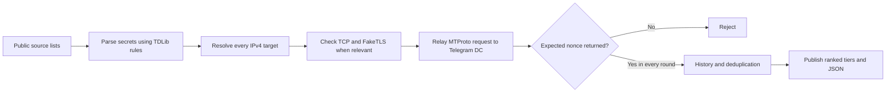

<div align="center">
  <a href="https://0xradikal.github.io/Free-Telegram-Proxy/"><picture><source media="(max-width: 600px)" srcset="assets/readme/hero-mobile.svg" /></picture></a>

  <h1>Free Telegram Proxy</h1>

  <p><strong>Real MTProto verification. Diverse servers. Open data.</strong></p>
  <p>A free, open-source Telegram proxy list, rebuilt about every 15 minutes. Every published verified link must relay a real request to a Telegram datacenter in all required test rounds.</p>

  <p>
    <a href="https://github.com/0xRadikal/Free-Telegram-Proxy/actions/workflows/update.yml"></a>
    <a href="https://raw.githubusercontent.com/0xRadikal/Free-Telegram-Proxy/main/index.json"></a>
    <a href="https://raw.githubusercontent.com/0xRadikal/Free-Telegram-Proxy/main/index.json"></a>
    <a href="LICENSE"></a>
  </p>

  <p>
    <a href="https://0xradikal.github.io/Free-Telegram-Proxy/"></a>
    <a href="https://raw.githubusercontent.com/0xRadikal/Free-Telegram-Proxy/main/top100.txt"></a>
    <a href="https://t.me/configexBot"></a>
    <a href="https://t.me/Raydikalx"></a>
    <a href="https://github.com/0xRadikal/Free-Telegram-Proxy"></a>
  </p>

  <p>
    <a href="README_FA.md">فارسی</a> ·
    <a href="README_RU.md">Русский</a> ·
    <a href="https://github.com/0xRadikal/Free-Telegram-Proxy/discussions">Discussions</a> ·
    <a href="https://github.com/0xRadikal/Free-Telegram-Proxy/issues">Report an issue</a>
  </p>
</div>

<picture></picture>

<a id="start-here--one-line"></a>

## Quick start

**Need a free Telegram MTProto proxy?** Start with the diversified list, not an unfiltered collection of duplicate links.

| Your goal | Recommended option |
| :-- | :-- |
| **Connect from your phone or computer** | **[Open the live proxy explorer](https://0xradikal.github.io/Free-Telegram-Proxy/)** |
| **Try a compact, diversified selection** | **[Recommended Top 100](https://raw.githubusercontent.com/0xRadikal/Free-Telegram-Proxy/main/top100.txt)** |
| **Browse one entry per proxy-server IP** | [Resilient proxy links](https://raw.githubusercontent.com/0xRadikal/Free-Telegram-Proxy/main/resilient/tme.txt) |
| **Prefer recently fast responses** | [Fast tier](https://raw.githubusercontent.com/0xRadikal/Free-Telegram-Proxy/main/fast/tme.txt) — measured from the test runner |
| **Want updates and the Telegram community?** | [@Raydikalx](https://t.me/Raydikalx) |

**On Android / iPhone:** open one of the proxy-link lists, tap a `t.me/proxy` link, then confirm **Connect proxy?** in Telegram. If it fails on your network, try another server. On Telegram Desktop, open a link or use **Settings → Advanced → Connection type → Use custom proxy → Add proxy → MTProto**.

> [!IMPORTANT]
> **Verified does not mean universally reachable.** Testing takes place from the project's runner, not from your ISP. Networks may block different proxies, and reliability changes over time.

### Open it on your phone

<div align="center">
<a href="https://raw.githubusercontent.com/0xRadikal/Free-Telegram-Proxy/main/top100.txt"></a>
<a href="https://t.me/configexBot"></a>
<a href="https://t.me/Raydikalx"></a>
</div>

### Prefer Telegram instead of switching between apps?

Open **[@configexBot](https://t.me/configexBot)** to access the project's Telegram bot. A repository-backed **free-proxy feature is planned**; until its availability is independently confirmed, use the dashboard or the lists above to obtain proxies. No signup is needed to browse the public repository data.

---

## Why this project exists

<p align="center"></p>

**A thousand proxy links can still be one point of failure.** A single real server may appear under hundreds of domains or secrets. Counting links alone can make a collection look more resilient than it is.

Raydikalx reports both **verified links** and **real server endpoints**, performs end-to-end MTProto checks, and publishes subsets optimized for different purposes:

| Principle | What this repository actually does |
| :-- | :-- |
| **End-to-end proof** | Requires a Telegram datacenter to answer a `req_pq_multi` request with the expected nonce—not just an open TCP port. |
| **Repeat verification** | Each published verified link passes every configured test round (**3 by default**). |
| **Server diversity** | `resilient/` keeps one link per server IP. The Top 100 also applies a network-diversity cap, which can rise when necessary. |
| **History-aware ranking** | The recommended selection favors proxies with established check histories before using runner-side latency. |
| **Auditable results** | [`index.json`](index.json), [`health.json`](health.json) and per-tier JSON expose counts, methods, rejection reasons and measured properties. |
| **Open source** | The verification pipeline, selection rules, tests, and documentation can be reviewed publicly. |

The original investigation behind the project found **958 of 1,394 working links resolving to one IP** in a study conducted on **2026-10-26**. This was a historical observation—not a claim that every external proxy list behaves this way. [Read the methodology](https://0xradikal.github.io/Free-Telegram-Proxy/methodology/).

## Live verification snapshot

The following section is **generated automatically from the current run**. Its timestamps, counts, testing location and country links come from the same published index as the proxy files.

<!-- LIVE:BEGIN -->
<!-- LIVE:END -->

*The figures above describe the most recent published run, not a promise that every proxy will connect from every network.*

---

<a id="tiers"></a>

## Choose the right list

| List | Selection rule | Best for |
| :-- | :-- | :-- |
| **[`top100.txt`](top100.txt)** ⭐ | Up to 100 diversified links from `resilient/`; history first, then latency; usually at most 5 per network. | Most users |
| [`resilient/`](resilient/tme.txt) | Verified, with one published link per server IP. | Broad server diversity |
| [`stable/`](stable/tme.txt) | Resilient entries with at least 90% success over the qualifying check history. | Established reliability history |
| [`fast/`](fast/tme.txt) | Fastest quarter of `resilient/`, using measured runner-side RTT. | Low latency from the tester |
| [`verified/`](verified/tme.txt) | Every link that passed all verification rounds; may include multiple aliases for the same server. | Comprehensive verified links |
| [`faketls/`](faketls/tme.txt) | Verified FakeTLS (`ee`) secret format. | A specific MTProto variant |
| [`secure/`](secure/tme.txt) / [`classic/`](classic/tme.txt) | Verified `dd` and classic secrets, respectively. | Protocol compatibility |
| [`countries/`](countries/) | Country of the **proxy server**, not a guarantee of access from that country. | Location-based exploration |
| [`all/`](all/tg.txt) | Collected candidates, **including unverified or failed entries**. | Research only |

The legacy [`top50.txt`](top50.txt) is preserved as the first 50 lines of Top 100. A tier with no qualifying records in a particular run may be absent rather than published as an empty file.

**Link formats:** most tiers offer `tg.txt` (`tg://proxy`), `tme.txt` (`https://t.me/proxy`) and `proxies.json` (structured records). See the [data guide](https://0xradikal.github.io/Free-Telegram-Proxy/data/) for schema and selection criteria.

<details>
<summary><strong>Alternative download when GitHub raw content is inaccessible</strong></summary>

The same published path is available through a jsDelivr mirror:

```text
https://cdn.jsdelivr.net/gh/0xRadikal/Free-Telegram-Proxy@main/top100.txt
```

The publisher attempts to purge jsDelivr caches after updates, but CDN caches may lag behind the repository. Check [`index.json`](index.json) for the published timestamp.

</details>

---

<a id="how-a-proxy-is-tested"></a>

## How verification works

<picture><source media="(max-width: 600px)" srcset="assets/readme/pipeline-mobile.svg" /></picture>



The critical distinction is a **real datacenter response**: the proxy must relay `req_pq_multi` and return `resPQ` containing the challenge nonce. FakeTLS candidates also need a valid secret-dependent handshake. If a hostname resolves to multiple IPv4 addresses, the project checks all of them instead of trusting just one reachable address.

Details, test limitations and failure modes are documented in the [verification methodology](https://0xradikal.github.io/Free-Telegram-Proxy/methodology/) and the open-source pipeline. Results are measured from the runner; they are **not** on-device latency or a guarantee of accessibility from Iran, Russia or any other particular network.

<a id="machine-readable"></a>

## Open data for developers and researchers

The project publishes files you can read without an API token or account.

| File | What you get |
| :-- | :-- |
| [`index.json`](index.json) | Schema version, update timestamp, runner location, funnel metrics, tier counts and published file URLs. |
| [`health.json`](health.json) | Source health, contribution statistics and rejection reasons. |
| [`resilient/proxies.json`](resilient/proxies.json) | Proxy records with fields such as `server`, `port`, `secret`, `type`, `country`, `rtt_ms`, `uptime` and `checks`. |
| [`top100.txt`](top100.txt) | Recommended ready-to-open proxy links. |
| [`CITATION.cff`](CITATION.cff) | Reproducible citation metadata for research and downstream references. |

```bash
# Inspect the current metadata. Read the returned file URLs instead of guessing paths.
curl -fsSL https://raw.githubusercontent.com/0xRadikal/Free-Telegram-Proxy/main/index.json \
  | python -m json.tool
```

For an app or bot, read the tier URL from `index.json`, validate the returned records, and handle empty or stale lists gracefully. The URL is public data, **not a continuously available or authenticated service**.

<a id="run-it-yourself"></a>

## Run the verifier locally

```bash
git clone https://github.com/0xRadikal/Free-Telegram-Proxy.git
cd Free-Telegram-Proxy
python -m pip install -r requirements.txt
python -m tgproxy --out ./output
```

To run the project's tests, install the development dependencies and execute:

```bash
python -m pip install -r requirements-dev.txt
python -m pytest -q -rs
```

Some checks require a working network, real Telegram datacenters and the local reference proxy test environment. A local failure should be diagnosed before it is attributed to the project.

---

<a id="honest-limits"></a>

## Security, privacy and honest limitations

- **A proxy is not a VPN.** It transports Telegram MTProto traffic; it does not protect all your device's connections.
- **The operator can observe connection metadata**, including your IP address and timing. Telegram's end-to-end and transport security properties depend on the type of conversation and client; a proxy should not be treated as a trusted party.
- **A verified result has a location and timestamp.** A proxy may fail on your ISP even if it passed the runner's checks.
- **Some public proxies may advertise sponsored channels.** The verifier cannot reliably determine post-login sponsored-channel behavior.
- **Do not confuse server location with your access location.** Country lists use the server's geolocation database information.
- **This project is independent** and is not affiliated with or endorsed by Telegram. Follow applicable laws and use the data responsibly.

See [SECURITY.md](SECURITY.md) to report security issues without disclosing sensitive details publicly.

<a id="faq"></a>

## Frequently asked questions

<details>
<summary><strong>Are the MTProto proxies free?</strong></summary>

Yes. The lists are publicly accessible, and the project does not require a paid account to browse them. Telegram itself is required to connect.

</details>

<details>
<summary><strong>Why does a verified proxy sometimes fail to connect?</strong></summary>

Verification proves an end-to-end connection **from the test runner during the test**, not connectivity from your carrier or country. Try another recently checked server or another tier.

</details>

<details>
<summary><strong>How often is the list updated?</strong></summary>

The project attempts a run about every **15 minutes**, subject to GitHub Actions, availability of public sources and network conditions. See the timestamp in the live snapshot or [`index.json`](index.json) for the actual latest publication.

</details>

<details>
<summary><strong>How are fake, duplicate or dead proxies handled?</strong></summary>

Links are parsed and tested against real datacenter responses; `verified/` includes links that passed all rounds, while `resilient/` reduces aliases by keeping one entry per server IP. The [`health.json`](health.json) report documents rejection and source health information.

</details>

<details>
<summary><strong>Can I use these proxy lists in my Telegram bot?</strong></summary>

Yes. Use [`index.json`](index.json) to discover current file paths and [`proxies.json`](resilient/proxies.json) for structured data. Honor the repository's MIT license and third-party data attribution where applicable.

</details>

## Community and credits

- **Telegram channel:** [@Raydikalx](https://t.me/Raydikalx) — project updates and community.
- **Telegram bot:** [@configexBot](https://t.me/configexBot) — free-proxy integration is planned; check the bot for current available functions.
- **Questions:** [GitHub Discussions](https://github.com/0xRadikal/Free-Telegram-Proxy/discussions).
- **Report a broken proxy or bug:** [Issues](https://github.com/0xRadikal/Free-Telegram-Proxy/issues).
- **Contribute:** [CONTRIBUTING.md](CONTRIBUTING.md) and [CODE_OF_CONDUCT.md](CODE_OF_CONDUCT.md).
- **Sources and attribution:** public repositories and Telegram channel previews documented in [`tgproxy/sources.py`](tgproxy/sources.py) and [`health.json`](health.json). IP country/ASN information uses [DB-IP](https://db-ip.com) (CC BY 4.0).

<div align="center">

  **Open source · Tested with evidence · Transparent about limitations**

  <a href="LICENSE">MIT License</a> · <a href="CITATION.cff">Cite this project</a> · <a href="https://0xradikal.github.io/Free-Telegram-Proxy/">Live dashboard</a>

  <sub>Built by <a href="https://github.com/0xRadikal">0xRadikal</a> · Raydikalx</sub>

</div>
